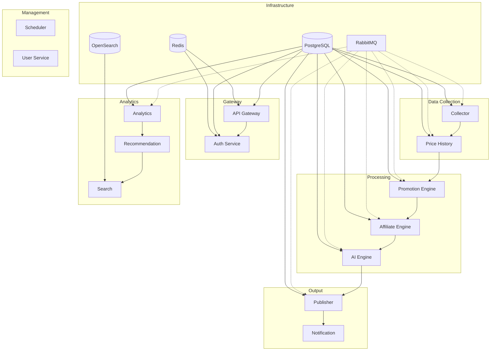

# Atlas Deals

**Plataforma SaaS automatizada de monitoramento e distribuicao de promocoes**

O Atlas Deals e uma plataforma completa para coleta, processamento e distribuicao de promocoes em escala. Utilizando uma arquitetura de microsservicos com comunicacao assincrona baseada em eventos, a plataforma e capaz de monitorar milhares de fontes de promocoes, aplicar regras de negocio, enriquecer dados com IA e distribuir conteudo para multiplos canais.

---

## Arquitetura



---

## Tech Stack

| Categoria | Tecnologia | Versao |
|-----------|-----------|--------|
| **Linguagem Backend** | Java | 21 |
| **Framework Backend** | Spring Boot | 3.4.3 |
| **Linguagem Frontend** | TypeScript | 5.4 |
| **Framework Frontend** | Next.js | 14.2 |
| **Banco Relacional** | PostgreSQL | 16 |
| **Cache** | Redis | 7 |
| **Mensageria** | RabbitMQ | 4 |
| **Busca** | OpenSearch | 2.18 |
| **Container Runtime** | Docker | latest |
| **Orquestracao** | Kubernetes | 1.30+ |
| **Monitoramento** | Prometheus + Grafana | latest |
| **Tracing** | Tempo (OpenTelemetry) | 2.6 |
| **Logs** | Loki | 3.2 |
| **CI/CD** | GitHub Actions | - |

---

## Estrutura do Projeto

```
atlas-deals/
├── .github/
│   └── workflows/
│       ├── ci.yml              # Pipeline de integracao continua
│       ├── deploy.yml           # Pipeline de deploy
│       └── security.yml         # Scans de seguranca
├── backend/
│   ├── atlas-deals-common/      # Biblioteca compartilhada
│   ├── atlas-deals-gateway/     # API Gateway (Spring Cloud Gateway)
│   ├── atlas-deals-auth/        # Autenticacao e autorizacao
│   ├── atlas-deals-user/        # Gerenciamento de usuarios
│   ├── atlas-deals-collector/   # Coleta de promocoes
│   ├── atlas-deals-price-history/ # Historico de precos
│   ├── atlas-deals-promotion-engine/ # Motor de promocoes
│   ├── atlas-deals-affiliate-engine/ # Engine de afiliados
│   ├── atlas-deals-ai-engine/   # Engine de IA
│   ├── atlas-deals-publisher/   # Publicacao de conteudo
│   ├── atlas-deals-notification/ # Notificacoes
│   ├── atlas-deals-analytics/   # Analytics
│   ├── atlas-deals-recommendation/ # Recomendacoes
│   ├── atlas-deals-scheduler/   # Agendador de tarefas
│   └── atlas-deals-search/      # Motor de busca
├── frontend/
│   ├── src/                     # Codigo fonte Next.js
│   └── Dockerfile               # Dockerfile do frontend
├── infra/
│   ├── docker/                  # Docker Compose para desenvolvimento
│   ├── k8s/                     # Manifestos Kubernetes
│   ├── prometheus/              # Configuracao Prometheus
│   ├── grafana/                 # Provisionamento Grafana
│   ├── loki/                    # Configuracao Loki
│   └── opensearch/              # Configuracao OpenSearch
├── docs/
│   ├── architecture/            # Documentacao arquitetural
│   ├── api/                     # Documentacao da API
│   └── decisions/               # ADRs (Architecture Decision Records)
├── scripts/                     # Scripts de automacao
├── pom.xml                      # POM raiz (Maven multi-module)
└── README.md                    # Este arquivo
```

---

## Pre-requisitos

- **Java** 21 (Temurin recomendado)
- **Node.js** 20 LTS
- **Docker** & **Docker Compose**
- **Maven** 3.9+
- **Git**

---

## Quick Start

```bash
# Clone o repositorio
git clone https://github.com/atlas-deals/atlas-deals.git
cd atlas-deals

# Inicie a infraestrutura (PostgreSQL, Redis, RabbitMQ)
.\scripts\start-infra.ps1

# Build e teste o backend
mvn clean package -DskipTests

# Inicie todos os servicos
.\scripts\start-all.ps1
```

Acesse:
- **Frontend:** http://localhost:3000
- **API Gateway:** http://localhost:8080
- **RabbitMQ Console:** http://localhost:15672
- **Grafana:** http://localhost:3001

---

## Desenvolvimento

### Ambiente Local

```bash
# Terminal 1 - Infraestrutura
docker compose -f infra/docker/docker-compose.yml up

# Terminal 2 - Backend (todos os modulos)
mvn clean compile -Pdev
mvn spring-boot:run -pl backend/atlas-deals-gateway

# Terminal 3 - Frontend
cd frontend
npm install
npm run dev
```

### Variaveis de Ambiente

| Variavel | Descricao | Default |
|----------|-----------|---------|
| `DB_HOST` | Host do PostgreSQL | localhost |
| `DB_PORT` | Porta do PostgreSQL | 5432 |
| `REDIS_HOST` | Host do Redis | localhost |
| `REDIS_PORT` | Porta do Redis | 6379 |
| `RABBITMQ_HOST` | Host do RabbitMQ | localhost |
| `RABBITMQ_PORT` | Porta do RabbitMQ | 5672 |

---

## Testes

```bash
# Backend - todos os testes com cobertura
mvn clean verify

# Backend - apenas testes unitarios
mvn clean test

# Frontend - lint e typecheck
cd frontend
npm run lint
npm run typecheck

# Frontend - build de producao
npm run build
```

Relatorios de cobertura sao gerados em `**/target/site/jacoco/index.html`.

---

## Deploy

O deploy e automatizado via GitHub Actions. Ao criar uma tag semantica (`v1.2.3`), o pipeline:

1. Builda todas as imagens Docker
2. Publica no GitHub Container Registry (`ghcr.io/atlas-deals/*`)
3. Atualiza os manifestos Kubernetes
4. Aplica e verifica o rollout

```bash
git tag v1.2.3
git push origin v1.2.3
```

Deploys manuais tambem sao suportados via **Actions > Deploy > Run workflow**.

---

## Contribuindo

1. Crie uma branch a partir de `develop`: `git checkout -b feature/nome-da-feature`
2. Faca suas alteracoes
3. Execute os testes: `mvn clean verify`
4. Commit usando [Conventional Commits](https://www.conventionalcommits.org/): `feat: descricao`
5. Abra um Pull Request para `develop`

### Padroes de Commit

- `feat:` - Nova funcionalidade
- `fix:` - Correcao de bug
- `refactor:` - Refatoracao
- `test:` - Testes
- `docs:` - Documentacao
- `chore:` - Tarefas de manutencao

---

## Licenca

Copyright 2024 Atlas Deals. Todos os direitos reservados.

Este projeto e propriedade intelectual da Atlas Deals. Distribuicao ou modificacao nao autorizada e proibida.
